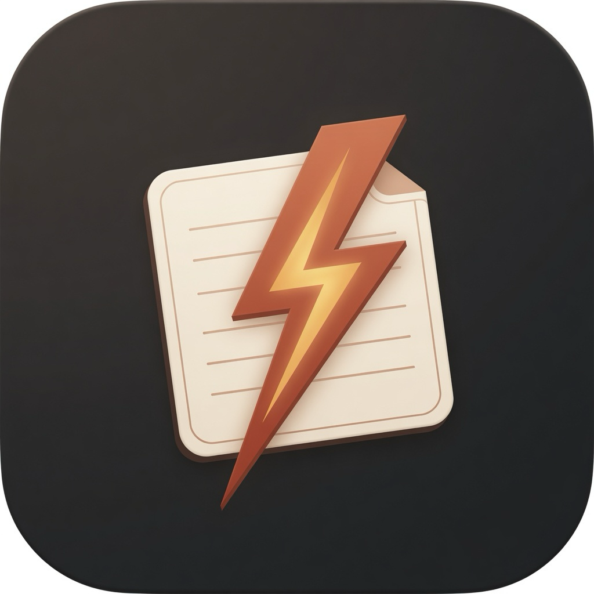

# FlashCapture

<p align="center">
  
</p>

Lightweight desktop flashcards for learning while you work. Highlight text anywhere, hit a global hotkey, write a quick question, and save a card locally.

**macOS primary · MIT licensed**

> **Notice:** This project was built with AI assistance (Grok Build). Treat it as an early prototype: review the code before relying on it, and expect rough edges.
>
> **Windows:** The app is written to target Windows as well as macOS, but **Windows builds and runtime behavior are untested** as of this release. macOS is the supported / verified platform today.

## Features

- **Quick Capture** — global hotkey treats your selection as the card **answer**, then opens a popup for the **question**
- **Decks + tags** — organize, filter, and search
- **Quiz** — flip cards and mark Knew / Didn't know
- **Portable JSON** — export/import your library between machines
- **Tray app** — stays in the menu bar; closing the window hides to tray
- **Live sync** — library reloads when `cards.json` changes (CLI / other tools)
- **CLI + MCP** — add and manage cards from a terminal or any MCP-capable agent

## Requirements

- [Node.js](https://nodejs.org/) 18+
- [Rust](https://rustup.rs/) (stable)
- macOS (verified). Windows may work via Tauri but is **untested**.

### macOS Accessibility

FlashCapture simulates `⌘C` to grab the current selection. Grant **Accessibility**:

1. **System Settings → Privacy & Security → Accessibility**
2. Enable **FlashCapture** (or your terminal / IDE when running `tauri dev`)

Without Accessibility, capture falls back to the current clipboard contents.

## Develop

```bash
git clone https://github.com/charlieolinsky/flash-capture.git
cd flash-capture
npm install
npm run tauri dev
```

Default capture hotkey: `CommandOrControl+Shift+F` (`⌘⇧F` on Mac, `Ctrl+Shift+F` on Windows).

## Build

```bash
npm run tauri build
```

Artifacts land under `src-tauri/target/release/bundle/`:

| Platform | Output |
|----------|--------|
| macOS | `macos/FlashCapture.app`, `dmg/*.dmg` (verified) |
| Windows | `.msi` / `.exe` when built on Windows (**untested**) |

## Data location

Cards and settings are plain JSON in the OS app data directory:

| OS | Path |
|----|------|
| macOS | `~/Library/Application Support/flashcapture/` |
| Windows | `%APPDATA%\flashcapture\` |
| Linux | `~/.local/share/flashcapture/` |

Files:

- `cards.json` — decks and cards
- `settings.json` — hotkey, theme, default deck
- `cards.json.bak` — previous write backup

Override with `FLASHCAPTURE_DATA_DIR` (desktop app, CLI, and MCP all honor this).

## JSON schema (export)

```json
{
  "version": 1,
  "decks": [{ "id": "…", "name": "General", "createdAt": "…" }],
  "cards": [
    {
      "id": "…",
      "deckId": "…",
      "question": "…",
      "answer": "…",
      "tags": ["rust"],
      "createdAt": "…",
      "updatedAt": "…",
      "stats": {
        "timesReviewed": 0,
        "timesKnew": 0,
        "timesForgot": 0,
        "lastReviewedAt": null
      }
    }
  ]
}
```

Use **Settings → Export JSON** / **Import merge** (or **Import replace**) to move libraries between devices.

## Agent interface (CLI + MCP)

The repo ships a Node CLI that reads and writes the same `cards.json` as the desktop app. The library window reloads when that file changes.

### CLI

From this repo (Node 18+):

```bash
node cli/flashcapture.mjs --help
# or: npm run cli -- --help
```

Add a card:

```bash
node cli/flashcapture.mjs cards add \
  -q "What is Tauri?" \
  -a "A toolkit for building native apps with a web frontend" \
  --deck General \
  --tags rust,tauri
```

Useful commands:

```bash
node cli/flashcapture.mjs decks list
node cli/flashcapture.mjs cards list --search tauri
node cli/flashcapture.mjs cards add -q "Question" -a "Answer"
node cli/flashcapture.mjs data-dir
```

Optional install onto your `PATH`:

```bash
npm link
flashcapture cards list
```

Point at another library with `--data-dir` or `FLASHCAPTURE_DATA_DIR`. Use the same directory the desktop app uses if you want live sync.

### MCP server

Start the stdio MCP server:

```bash
node cli/flashcapture.mjs mcp
```

Example Cursor / Claude Desktop / other MCP host config:

```json
{
  "mcpServers": {
    "flashcapture": {
      "command": "node",
      "args": ["/absolute/path/to/flash-capture/cli/flashcapture.mjs", "mcp"]
    }
  }
}
```

Tools: `add_card`, `list_cards`, `get_card`, `update_card`, `delete_card`, `list_decks`, `add_deck`, `rename_deck`, `delete_deck`, `library_info`.

If the desktop app is running, new cards show up in Library through the existing file watcher.

## Tray menu

- **Open Library** — show the main window
- **Quick Capture (clipboard)** — open capture with current clipboard text
- **Quit** — exit the app

## Tech stack

- [Tauri 2](https://tauri.app/) + React + TypeScript + Vite + Tailwind CSS
- Local JSON storage (no account, no cloud)

## License

[MIT](LICENSE)
